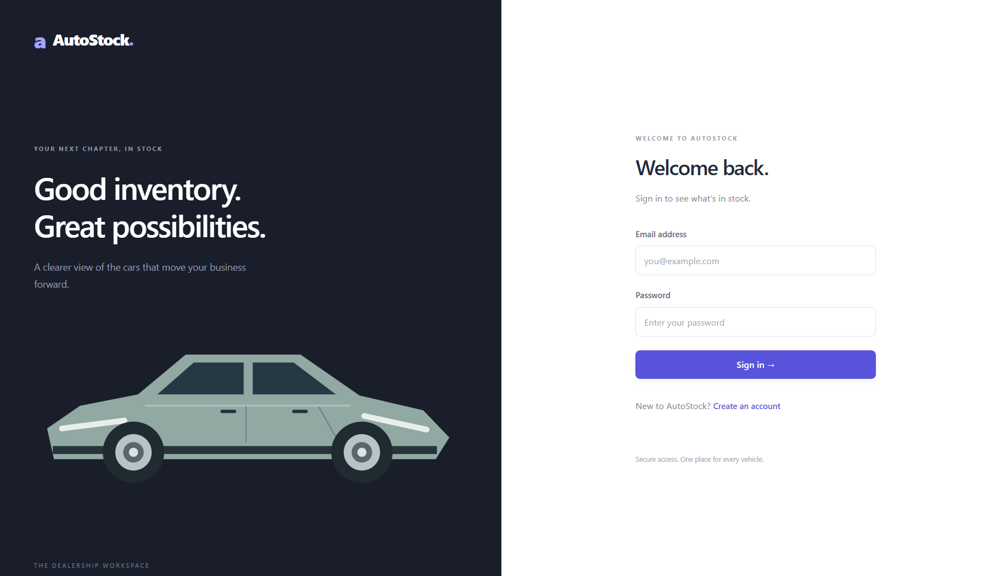
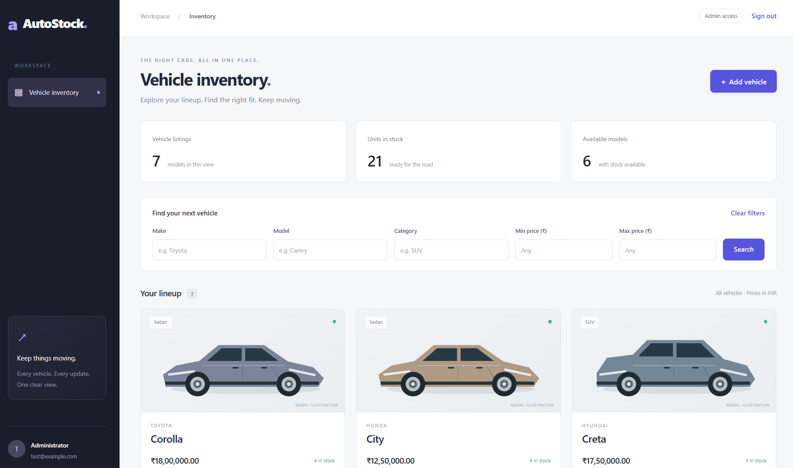
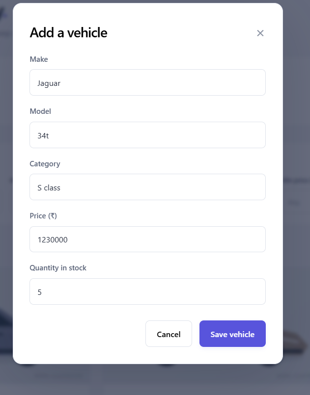
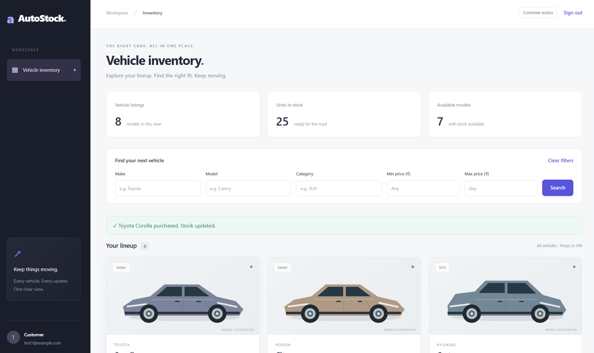

# AutoStock — Car Dealership Inventory System

**Author:** Ashish Ranjan

AutoStock is a full-stack inventory application for a car dealership. Customers can create an account, browse and filter vehicles, and purchase available stock. Administrators manage vehicle listings and restock inventory.

A purchase is an inventory operation: it reduces stock by one. **No payment is collected.** Vehicle names and prices are demonstration data, not live dealership offers.

## Features

- Customer registration and sign-in with expiring JWT access tokens.
- Role-based access enforced by the backend.
- Vehicle inventory with make, model, category, price and quantity.
- Search by make, model, category and minimum/maximum price.
- Purchase one unit, with unavailable vehicles shown as out of stock.
- Administrator-only vehicle creation, editing, deletion and restocking.
- Persistent SQLite storage locally, hosted PostgreSQL on Vercel, and explicit administrator setup.
- Responsive React interface with validation, loading states and action feedback.

## Screenshots

### Sign in


### Administrator inventory


### Add a vehicle


### Customer purchase


Screenshots show the application running locally. Stock counts vary as vehicles are added, purchased and restocked.

## Technology

| Layer | Technology | Purpose |
|---|---|---|
| Frontend | React, TypeScript, Vite | Single-page interface and API integration |
| Styling | Tailwind CSS and CSS | Layout, responsive styling and reusable visual patterns |
| Backend | Python, FastAPI | REST API, validation and access control |
| Database | SQLite locally or PostgreSQL on Vercel, with SQLAlchemy | Persistent users and inventory |
| Authentication | PyJWT and Argon2 through pwdlib | Access tokens and password hashing |

The application does not call an AI service at runtime.

## Run locally on Windows

### Prerequisites

- Python 3.12 or newer. Python 3.13 was used for the demonstrated local setup.
- Node.js 22 or newer, including npm.
- Git, if cloning the repository.
- Two terminal windows: one for the API and one for the frontend.

### Quick start with the included launchers

After cloning or extracting the repository, double-click `setup.bat`. It installs dependencies, creates private configuration if missing and prompts you to create an administrator. Then double-click `runme.bat` to start both servers and open the browser.

Keep both server windows open while using the app. Stop previous server instances before restarting. Existing configuration, accounts and inventory are preserved on setup reruns. The manual steps below are an alternative if you prefer to run each command yourself.

### 1. Get the source

```powershell
git clone https://github.com/SheesshhOfficial/AutoStock-DealershipInventorySystem.git
cd AutoStock-DealershipInventorySystem
```

The commands below run from this repository root unless a directory change is shown.

### 2. Install backend dependencies

```powershell
python -m venv .venv
& ".venv/Scripts/python.exe" -m pip install -r backend/requirements.txt
```

### 3. Create private configuration

Create `backend/.env` from `backend/.env.example` only if it does not already exist:

```powershell
if (!(Test-Path "backend/.env")) {
    Copy-Item "backend/.env.example" "backend/.env"
}
& ".venv/Scripts/python.exe" -c "import secrets; print(secrets.token_hex(32))"
notepad backend/.env
```

Put the generated random value after `JWT_SECRET=` in the file. Keep the database and frontend-origin settings from the example. Save and close the editor.

**Keep `.env`, passwords, tokens and the local database out of Git and screenshots. Never use the example secret or a shared default password.** If a secret is exposed, replace it and restart the backend; existing tokens will become invalid.

### 4. Create an administrator and sample inventory

```powershell
Set-Location backend
& "../.venv/Scripts/python.exe" -m app.seed --admin-email your-email@example.com
```

Replace the example email with your chosen administrator email. Enter your own password of 10–128 characters twice. Password input is hidden.

This creates one administrator and adds six demonstration vehicles only when the inventory is empty. There is no default administrator password. If the email already exists, the command stops without resetting that account.

### 5. Start the backend

From `backend`:

```powershell
& "../.venv/Scripts/python.exe" -m uvicorn app.main:create_app --factory --reload
```

Keep this window open. The API runs at `http://127.0.0.1:8000`.

- API documentation: http://127.0.0.1:8000/docs
- Health check: http://127.0.0.1:8000/api/health

### 6. Start the frontend

Open a second PowerShell window at the repository root:

```powershell
Set-Location frontend
npm.cmd ci
npm.cmd run dev
```

Open **http://127.0.0.1:5173** and sign in with the administrator credentials created above. Use the registration screen to create a separate customer account.

Both servers must remain running. To stop the application, press `Ctrl+C` in both terminal windows.

## Deploy on Vercel

The root [vercel.json](vercel.json) defines a Vite frontend service and a FastAPI backend service on one Vercel project. Browser requests to `/api/*` reach FastAPI on the same domain; the frontend needs no public API URL. This uses Vercel Services, so deploy from the **repository root**, with a current Vercel CLI and Services available for your account.

1. Create a hosted PostgreSQL database (for example, through a Vercel Marketplace provider). **Do not use the local SQLite URL:** Vercel functions cannot persist a shared SQLite file. Existing local SQLite accounts and vehicles are not automatically migrated.
2. Import this Git repository into Vercel, leaving the project's **Root Directory at the repository root**. Set the project Framework Preset to **Services** in Build and Deployment settings. The `vercel.json` file builds both services. Python 3.12 is selected in `backend/.python-version`.
3. In Vercel Project Settings → Environment Variables, set `DATABASE_URL` to the provider's PostgreSQL connection URL and `JWT_SECRET` to a new random secret of at least 32 characters. Set these for every environment you intend to deploy. Keep both values private and redeploy after changing them. A `postgres://` or `postgresql://` URL is accepted; the backend uses the psycopg driver.
4. Deploy and visit `/api/health` on the deployment URL. The frontend is at `/`. The backend creates the database tables on startup.
5. Create the first administrator from a trusted local machine with backend dependencies installed. Temporarily set `DATABASE_URL` to that hosted database and `JWT_SECRET` to the deployment secret in your local environment, then from `backend/` run `python -m app.seed --admin-email your-email@example.com`. Enter the password interactively. This adds sample vehicles only if inventory is empty. Clear the temporary environment values afterward.

Customer registration creates customer accounts only. The database provider may require SSL or a pooled connection URL; use the connection string it gives for application traffic. Preview and production deployments should use separate databases and JWT secrets if their data must stay separate. No payment processing is provided.

## Using the application

### Customer

1. Register an account and sign in.
2. Browse inventory or combine the search filters.
3. Click **Purchase** to buy one unit from a vehicle listing.
4. Check the success message and updated stock count. The purchase button is disabled when stock is zero.

### Administrator

1. Sign in with the account created by the seed command.
2. Add a vehicle with its make, model, category, price and initial quantity.
3. Edit vehicle details, restock units or delete a listing.
4. Refresh if another action changes stock while the edit form is open.

Registering through the public form never creates an administrator. Administrator controls are also protected at the API level.

## API overview

| Method | Endpoint | Access | Purpose |
|---|---|---|---|
| POST | `/api/auth/register` | Public | Create a customer account |
| POST | `/api/auth/login` | Public | Obtain an access token |
| GET | `/api/vehicles` | Signed-in user | List vehicles |
| GET | `/api/vehicles/search` | Signed-in user | Filter vehicles |
| POST | `/api/vehicles` | Administrator | Add a vehicle |
| PUT | `/api/vehicles/{id}` | Administrator | Update vehicle details |
| DELETE | `/api/vehicles/{id}` | Administrator | Delete a vehicle |
| POST | `/api/vehicles/{id}/purchase` | Signed-in user | Purchase one unit |
| POST | `/api/vehicles/{id}/restock` | Administrator | Increase stock |

Interactive request/response schemas are available in `/docs` while the backend is running.

## Design decisions

- **Simple separation of responsibilities:** authentication, vehicle APIs, inventory operations, persistence and UI components have separate files.
- **Persistent local database:** SQLite avoids a separate database-server installation while retaining data between runs.
- **Money uses integer minor units internally:** this avoids floating-point rounding in stored prices; the UI displays INR.
- **Atomic stock updates:** purchase checks availability and decrements stock in one database operation to prevent overselling the final unit.
- **Safe editing:** stale inventory edits return a conflict rather than restoring a quantity changed by another purchase. Restocking is a separate operation.
- **Administrator-only management:** create/update are restricted to admins as a deliberate interpretation of the assessment's admin management UI.
- **Zero-stock listings remain visible:** users can see that an item is unavailable rather than having it disappear.

## Verification

Ashish Ranjan reported manually testing the following on Windows:

- Registration and login.
- Search and filtering.
- Adding, editing and deleting vehicles as an administrator.
- Purchasing, restocking and out-of-stock behaviour.

The screenshots show the local interface and customer purchase feedback. These manual checks are distinct from automated test execution.

The current repository includes frontend behavior tests and backend API tests. See [TEST_REPORT.md](TEST_REPORT.md) for the results and the backend execution limitation on this machine. These tests were added after the existing implementation; they do not establish a historical test-first development sequence.

To check the frontend locally:

```powershell
cd frontend
npm.cmd run typecheck
npm.cmd run build
npm.cmd test
```

To run the backend tests, use a working Python environment with package access:

```powershell
& ".venv/Scripts/python.exe" -m pip install -r backend/requirements-test.txt
Set-Location backend
& "../.venv/Scripts/python.exe" -m pytest -q
```

## My AI Usage

### Tool used

ChatGPT was used to help write this README. After the project was built, ChatGPT was also asked to review it and fix issues found in that review.

### How it was used

The prompt used for the README was: "make me a perfect readme file for this project  ". During the later review, ChatGPT helped identify the filter and stale-result defects, change the frontend code, add automated tests, and update the documentation. The review prompts are recorded in [PROMPTS.md](PROMPTS.md).

### My contribution

I built the original application myself. I set it up and ran it locally, created administrator credentials, manually checked registration, login, search/filter, vehicle creation, editing, deletion, purchasing, restocking and out-of-stock behaviour, and provided screenshots. I reviewed the AI-assisted README and the later repair work.

### Reflection

> debugging and error handling is easy with ai and the person with enough knowledge can create wonders with ai

— Ashish Ranjan

### Conversation record

The root [PROMPTS.md](PROMPTS.md) records the exact README prompt supplied by the author and the review and repair prompts visible in this conversation. The full earlier README chat transcript was not supplied. The original test-first history cannot be established retroactively.

## Troubleshooting

- **`ECONNREFUSED 127.0.0.1:8000`:** the frontend cannot reach the API. Start the backend in the second terminal and confirm `/api/health` responds.
- **404 at backend `/`:** the API has no homepage at its root. Open the frontend on port 5173 or API docs at `/docs`.
- **Account already exists:** use **Sign in**, not **Create account**. The seed command does not reset passwords.
- **Password validation failure:** use a password between 10 and 128 characters.
- **Expired login:** sign in again. Access tokens expire after 30 minutes by default.
- **Invalid JWT configuration:** generate a private random secret, update `backend/.env` and restart the backend.
- **Port already in use:** stop the earlier app servers before starting another pair.

## Scope and limitations

This is an assessment application, not a production dealership/payment platform. It does not provide payment processing, order fulfilment or password recovery. A public deployment requires additional operational and security hardening.
